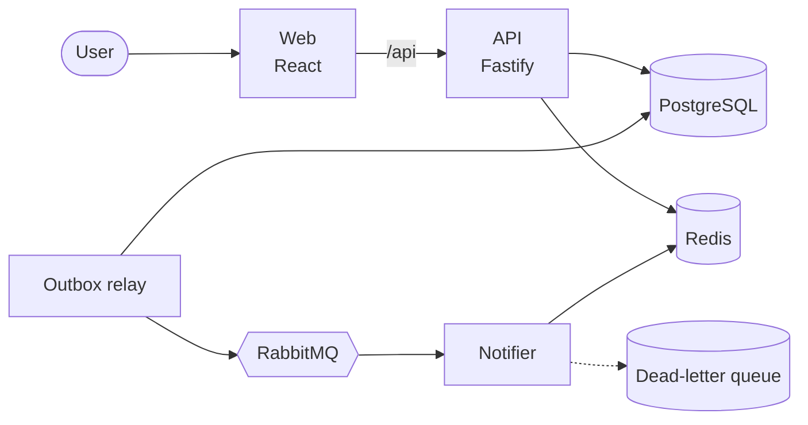
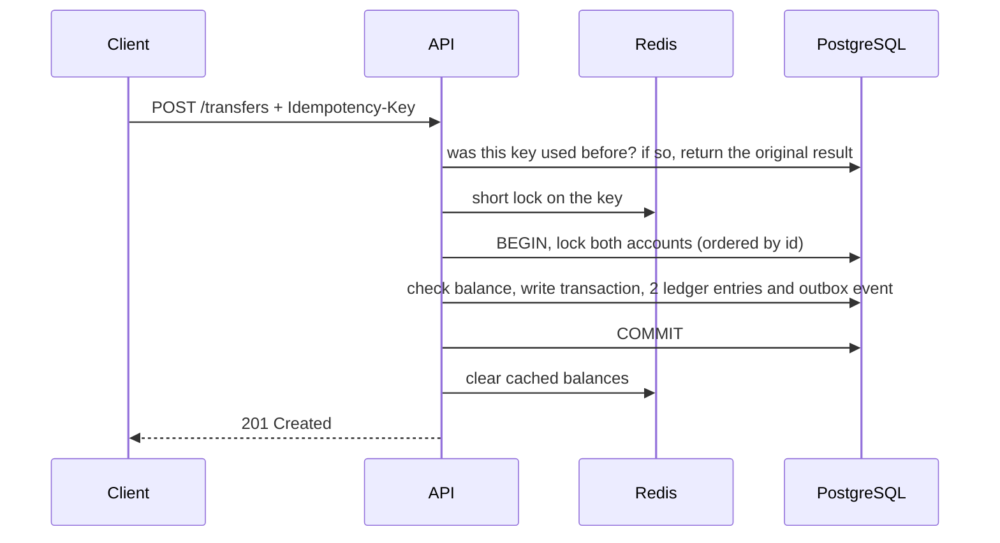

# Fintech Wallet Platform

**English** · [Português](README.pt-BR.md)

[](https://github.com/mikaelapg/fintech-wallet-platform/actions/workflows/ci.yml)


A digital wallet: users sign up, get a BRL account, deposit money and send transfers to each other by email.

I built it to practice the parts of payment systems that are easy to get wrong: two requests touching the same balance at the same time, a client retrying a request that already went through, and an event that has to reach another service even if something crashes halfway.

## Architecture



- **api**: REST API with auth, balance, statement, deposits and transfers. It owns the ledger.
- **relay**: a second process built from the API image. It reads pending events from the database and publishes them to RabbitMQ.
- **notifier**: consumes `transfer.completed` events and notifies sender and recipient.
- **web**: React app with login, balance, transfer form and statement.

## How a transfer is processed



## Design decisions

**Ledger.** Each operation is stored as a transaction with one debit and one credit of the same amount, like in accounting. The current balance is also kept on the account row so reads are cheap, and there is a test that checks it always matches the sum of the entries. Entries can't be updated or deleted (a trigger blocks it). A mistake would be fixed with a new transaction.

**Amounts in cents.** All amounts are integers in cents (`BIGINT` in Postgres). The frontend turns what the user types, like `1.234,56`, into `123456` using string parsing, so there's no floating point involved anywhere.

**Concurrency.** A transfer locks both account rows with `SELECT ... FOR UPDATE`, always in the same order (by id). Without the fixed order, a transfer from A to B and another from B to A at the same moment could deadlock. There's also a `CHECK (balance_cents >= 0)` constraint in case a bug ever slips past the code.

**Idempotency.** Transfer and deposit requests require an `Idempotency-Key` header. If the same key comes again, the API returns the original transfer instead of moving money again. Redis holds a short lock to reject duplicates arriving at the same time, but the real guarantee is a unique constraint in Postgres, so even losing Redis data can't cause a double transfer. Same key with a different body returns `422`.

**Outbox.** The event for another service is saved in the same database transaction as the transfer. The relay publishes it later and only marks it as sent after RabbitMQ confirms. This avoids the case where the transfer is saved but the event is lost (or the opposite). The relay uses `FOR UPDATE SKIP LOCKED`, so more than one replica can run without sending the same event twice.

**Consumer.** Delivery is at least once, so the notifier ignores events it has already processed (it keeps their ids in Redis). Temporary errors are retried with increasing delays. Invalid messages go to a dead-letter queue instead of being retried forever.

**Cache.** The balance is read from Redis first and the key is deleted after each transfer commits. Postgres is always the source of truth.

**Statement pagination.** It uses a cursor (`WHERE id < cursor`) instead of `OFFSET`, which keeps queries fast on long histories and doesn't skip or repeat items when new ones arrive.

**Security.** Passwords hashed with bcrypt, short-lived JWTs, rate limiting on login, no way to find out if an email is registered from the login response, sensitive fields removed from logs, containers running as non-root.

**Errors.** Errors follow RFC 9457 (problem details) and always include a `code` the frontend can map to a message, plus the request id for tracing.

## Running it

With Docker:

```bash
docker compose up --build
```

- Web app: http://localhost:8080
- API docs (Swagger): http://localhost:3333/docs
- RabbitMQ panel: http://localhost:15672 (guest / guest)

For development (Node.js 22 and pnpm 10):

```bash
cp .env.example .env
docker compose up -d postgres redis rabbitmq
pnpm install
pnpm --filter @wallet/api migrate
pnpm dev
```

## Tests

```bash
pnpm test
pnpm lint && pnpm typecheck
```

The API tests run against a real Postgres and Redis instead of mocks, since locks, constraints and triggers only behave like production in the real database. Some of the cases covered:

- 20 transfers of R$ 1,00 at the same time from an account with R$ 10,00: exactly 10 succeed and the balance ends at zero
- 20 transfers in opposite directions at the same time: no deadlock, balances stay correct
- 10 identical requests with the same key at the same time: money moves once
- after several transfers, the ledger is balanced and matches the account balances
- two relay replicas running together never publish the same event twice

The CI pipeline runs lint, type checking, all tests, validates the Kubernetes manifests and builds the Docker images.

## Endpoints

| Method | Path | |
|---|---|---|
| `POST` | `/auth/register` | Sign up (also creates the account) |
| `POST` | `/auth/login` | Returns a JWT |
| `GET` | `/me` | Logged user |
| `GET` | `/accounts/me/balance` | Balance |
| `GET` | `/accounts/me/statement` | Statement (`limit`, `cursor`) |
| `POST` | `/accounts/me/deposits` | Simulated deposit, needs `Idempotency-Key` |
| `POST` | `/transfers` | Transfer by recipient email, needs `Idempotency-Key` |
| `GET` | `/health/live`, `/health/ready` | Health checks |

```bash
curl -X POST http://localhost:3333/transfers \
  -H "Authorization: Bearer $TOKEN" \
  -H "Idempotency-Key: $(uuidgen)" \
  -H "Content-Type: application/json" \
  -d '{"recipientEmail":"bob@example.com","amountCents":2590,"description":"Pizza"}'
```

## Structure

```
apps/
  api/        API, ledger, outbox relay, SQL migrations and tests
  notifier/   RabbitMQ consumer
  web/        React frontend
k8s/          Kubernetes manifests
.github/      CI
```

## What I'd add next

- OpenTelemetry tracing across the three services
- Refresh tokens
- A reconciliation job that compares ledger and balances daily
- Terraform for running it on AWS

## License

MIT
