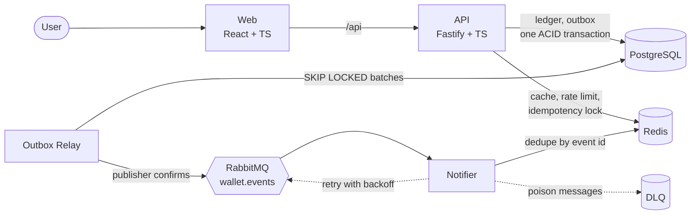
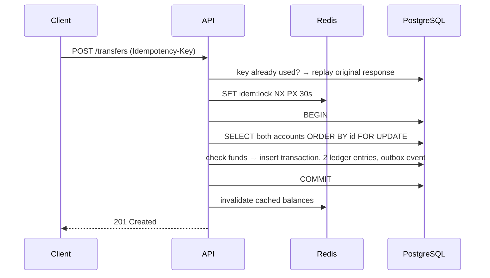

# Fintech Wallet Platform

[](https://github.com/mikaelapg/fintech-wallet-platform/actions/workflows/ci.yml)


A digital wallet where users hold a BRL balance and send money to each other — built around the problems that actually matter when software moves money: **correctness under concurrency, exactly-once effects on retries, and never losing an event**.

> Money is moved through a **double-entry ledger**, transfers are **idempotent**, balances **can't go negative even with 20 requests racing**, and events reach other services through a **transactional outbox**. Every one of these guarantees is covered by an automated test against a real PostgreSQL and Redis.

---

## Architecture



| Component | Responsibility |
|---|---|
| `apps/api` | REST API: auth (JWT), balance, statement, deposits, transfers. Owns the ledger. |
| `apps/api` · `relay` | Second process from the same image. Reads the outbox and publishes to RabbitMQ. |
| `apps/notifier` | Consumes `transfer.completed` and notifies sender and recipient. Idempotent, retries with exponential backoff, dead-letters poison messages. |
| `apps/web` | React SPA: sign up / login, balance, transfer form, infinite-scroll statement. |
| `k8s/` | Deployments with probes, HPA, PDB, rolling updates, hardened security contexts. |

## How a transfer works



## Technical decisions

**Double-entry ledger.** Every movement is one transaction with exactly one debit and one credit of the same amount. Balances are denormalized on `accounts` for fast reads, and a test asserts they always equal the sum of ledger entries. `ledger_entries` is append-only, enforced by a database trigger: mistakes are fixed with new transactions, never by editing history.

**Integer cents, never floats.** Amounts are `BIGINT` cents end to end. The frontend parses `"1.234,56"` into `123456` with string operations, so `0.1 + 0.2` problems can't happen.

**Concurrency without deadlocks.** Both accounts are locked with `SELECT … FOR UPDATE` in a deterministic order (by id). Opposite transfers A→B and B→A always acquire locks in the same order, so they serialize instead of deadlocking. The database also has a `CHECK (balance_cents >= 0)` as a last line of defense.

**Idempotency in two layers.** Clients send an `Idempotency-Key` header. A short Redis lock rejects concurrent duplicates fast (double clicks, retry storms); the durable guarantee is a `UNIQUE (initiator_user_id, idempotency_key)` constraint, so even if Redis is flushed money never moves twice. Retrying with the same key returns the original result with `Idempotent-Replayed: true`; reusing a key with a different payload returns `422`.

**Transactional outbox.** The `transfer.completed` event is inserted in the same database transaction as the money movement. A separate relay publishes it with RabbitMQ publisher confirms. That removes the dual-write problem: no event for a rolled-back transfer, no lost event for a committed one. The relay uses `FOR UPDATE SKIP LOCKED`, so multiple replicas share the work.

**At-least-once delivery, idempotent consumers.** A relay crash between publish and commit can resend an event, so the notifier deduplicates by event id in Redis. Transient failures are retried with exponential backoff through a TTL retry queue; malformed messages go straight to a dead-letter queue instead of looping forever.

**Cache-aside for balances.** Reads hit Redis first (`X-Cache: HIT|MISS`); writes invalidate after commit. The cache is never the source of truth.

**Keyset pagination.** The statement uses `WHERE id < cursor ORDER BY id DESC` on an `(account_id, id DESC)` index, which stays fast on long histories and doesn't skip or repeat rows when new entries arrive.

**Security.** bcrypt password hashing with constant-time behavior for unknown emails (no user enumeration), short-lived JWTs, Redis-backed rate limiting (strict on `/auth/login`), Helmet headers, request ids, secrets redacted from logs, non-root containers with read-only filesystems.

**Errors as RFC 9457 problem details.** Every error has a stable machine-readable `code`, field-level validation messages and the request id, so the frontend can show friendly messages and support can trace a request.

## Running locally

Requirements: Docker. For development without containers: Node.js 22 and pnpm 10.

```bash
docker compose up --build
```

| URL | What |
|---|---|
| http://localhost:8080 | Web app |
| http://localhost:3333/docs | OpenAPI / Swagger UI |
| http://localhost:15672 | RabbitMQ management (guest / guest) |

Development mode with hot reload:

```bash
cp .env.example .env
docker compose up -d postgres redis rabbitmq
pnpm install
pnpm --filter @wallet/api migrate
pnpm dev
```

## Tests

```bash
pnpm test          # all packages
pnpm lint && pnpm typecheck
```

API tests are **integration tests against real PostgreSQL and Redis** (no mocks for the database), because the guarantees that matter here — locking, constraints, triggers, isolation — only exist in the real engine. Highlights:

- 20 concurrent transfers from a R$ 10,00 balance → exactly 10 succeed, balance ends at 0
- 20 simultaneous opposite transfers → no deadlock, balances preserved
- 10 parallel requests with the same `Idempotency-Key` → money moves once
- the ledger stays balanced and matches account balances after a series of transfers
- ledger entries can't be updated or deleted
- two outbox relay replicas never publish the same event twice

CI runs lint, typecheck, unit and integration tests, validates Kubernetes manifests with kubeconform and builds the container images.

## API

| Method | Path | Description |
|---|---|---|
| `POST` | `/auth/register` | Create user and wallet account |
| `POST` | `/auth/login` | Get a JWT |
| `GET` | `/me` | Current user |
| `GET` | `/accounts/me/balance` | Balance (cached) |
| `GET` | `/accounts/me/statement?limit=&cursor=` | Statement, cursor pagination |
| `POST` | `/accounts/me/deposits` | Simulated cash-in · requires `Idempotency-Key` |
| `POST` | `/transfers` | Send money by recipient email · requires `Idempotency-Key` |
| `GET` | `/health/live`, `/health/ready` | Liveness and readiness probes |

```bash
curl -X POST http://localhost:3333/transfers \
  -H "Authorization: Bearer $TOKEN" \
  -H "Idempotency-Key: $(uuidgen)" \
  -H "Content-Type: application/json" \
  -d '{"recipientEmail":"bob@example.com","amountCents":2590,"description":"Pizza"}'
```

## Project structure

```
apps/
  api/        Fastify API, ledger, outbox relay, SQL migrations, integration tests
  notifier/   RabbitMQ consumer with retry and dead-letter queues
  web/        React + Vite + TanStack Query + Tailwind
k8s/          Kustomize manifests (Deployments, HPA, PDB, Ingress)
.github/      CI pipeline
```

## Next steps

- Distributed tracing with OpenTelemetry across API, relay and notifier
- Refresh tokens with rotation
- Scheduled transfers and a reconciliation job comparing ledger and balances
- Terraform for the AWS infrastructure (RDS, ElastiCache, Amazon MQ, EKS)

## License

MIT
