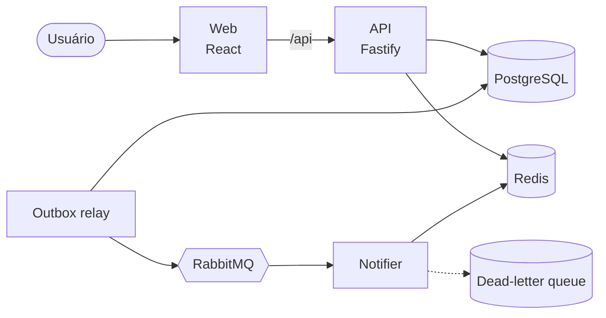
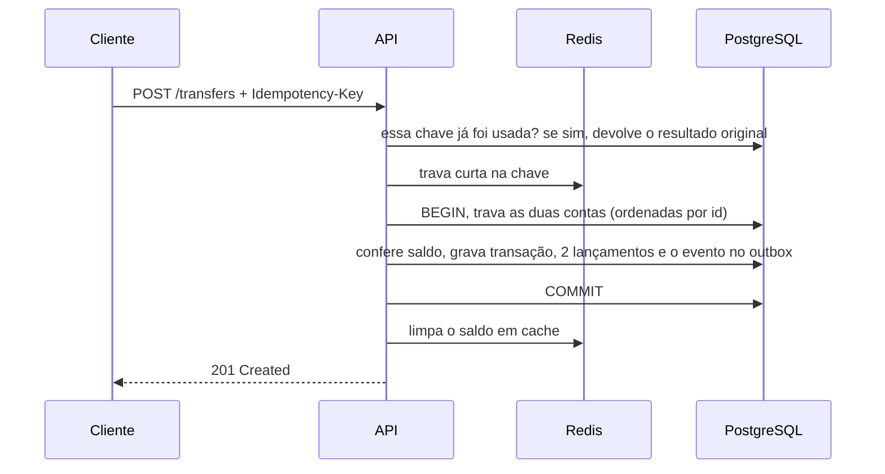

# Fintech Wallet Platform

[English](README.md) · **Português**

[](https://github.com/mikaelapg/fintech-wallet-platform/actions/workflows/ci.yml)


Uma carteira digital: a pessoa se cadastra, ganha uma conta em reais, faz depósitos e transfere dinheiro para outras pessoas pelo e-mail.

Fiz este projeto para praticar as partes de sistemas de pagamento que costumam dar problema: duas requisições mexendo no mesmo saldo ao mesmo tempo, um cliente reenviando uma requisição que já tinha sido processada, e um evento que precisa chegar em outro serviço mesmo que algo caia no meio do caminho.

## Arquitetura



- **api**: API REST com autenticação, saldo, extrato, depósitos e transferências. É dona do ledger.
- **relay**: um segundo processo, gerado a partir da mesma imagem da API. Lê os eventos pendentes no banco e publica no RabbitMQ.
- **notifier**: consome os eventos `transfer.completed` e notifica quem enviou e quem recebeu.
- **web**: app em React com login, saldo, formulário de transferência e extrato.

## Como uma transferência é processada



## Decisões técnicas

**Ledger.** Cada operação é gravada como uma transação com um débito e um crédito do mesmo valor, como na contabilidade. O saldo atual também fica na própria conta para a leitura ser rápida, e um teste garante que ele sempre bate com a soma dos lançamentos. Lançamentos não podem ser alterados nem apagados (um trigger impede). Um erro seria corrigido com uma nova transação.

**Valores em centavos.** Todo valor é um inteiro em centavos (`BIGINT` no Postgres). O front converte o que a pessoa digita, como `1.234,56`, em `123456` tratando como texto, então não existe ponto flutuante em nenhum lugar.

**Concorrência.** A transferência trava as duas contas com `SELECT ... FOR UPDATE`, sempre na mesma ordem (pelo id). Sem essa ordem fixa, uma transferência de A para B e outra de B para A no mesmo instante poderiam gerar deadlock. Também existe uma constraint `CHECK (balance_cents >= 0)` caso algum bug passe pelo código.

**Idempotência.** Transferências e depósitos exigem o header `Idempotency-Key`. Se a mesma chave chegar de novo, a API devolve a transferência original em vez de movimentar o dinheiro outra vez. O Redis guarda uma trava curta para barrar duplicadas que chegam juntas, mas a garantia de verdade é uma constraint única no Postgres, então nem perder os dados do Redis causa transferência dupla. Mesma chave com outro corpo retorna `422`.

**Outbox.** O evento para o outro serviço é gravado na mesma transação do banco que a transferência. O relay publica depois e só marca como enviado quando o RabbitMQ confirma o recebimento. Isso evita o caso em que a transferência é salva e o evento se perde (ou o contrário). O relay usa `FOR UPDATE SKIP LOCKED`, então dá para rodar mais de uma réplica sem enviar o mesmo evento duas vezes.

**Consumidor.** A entrega é "pelo menos uma vez", então o notifier ignora eventos que já processou (guarda os ids no Redis). Erros temporários são tentados de novo com intervalos crescentes. Mensagens inválidas vão para uma dead-letter queue em vez de ficarem em loop.

**Cache.** O saldo é lido primeiro do Redis, e a chave é apagada depois do commit de cada transferência. O Postgres é sempre a fonte da verdade.

**Paginação do extrato.** Usa cursor (`WHERE id < cursor`) em vez de `OFFSET`, o que mantém a consulta rápida em históricos longos e não pula nem repete itens quando entram lançamentos novos.

**Segurança.** Senhas com bcrypt, JWT de curta duração, rate limit no login, a resposta do login não revela se um e-mail está cadastrado, campos sensíveis removidos dos logs, containers rodando sem root.

**Erros.** Os erros seguem a RFC 9457 (problem details) e sempre trazem um `code` que o front transforma em mensagem, além do id da requisição para rastreio.

## Como rodar

Com Docker:

```bash
docker compose up --build
```

- App: http://localhost:8080
- Documentação da API (Swagger): http://localhost:3333/docs
- Painel do RabbitMQ: http://localhost:15672 (guest / guest)

Para desenvolvimento (Node.js 22 e pnpm 10):

```bash
cp .env.example .env
docker compose up -d postgres redis rabbitmq
pnpm install
pnpm --filter @wallet/api migrate
pnpm dev
```

## Testes

```bash
pnpm test
pnpm lint && pnpm typecheck
```

Os testes da API rodam contra um Postgres e um Redis de verdade em vez de mocks, porque travas, constraints e triggers só se comportam como em produção no banco real. Alguns dos cenários cobertos:

- 20 transferências de R$ 1,00 ao mesmo tempo saindo de uma conta com R$ 10,00: exatamente 10 passam e o saldo termina em zero
- 20 transferências em sentidos opostos ao mesmo tempo: sem deadlock e com os saldos corretos
- 10 requisições iguais com a mesma chave ao mesmo tempo: o dinheiro sai uma vez só
- depois de várias transferências, o ledger fecha e bate com os saldos das contas
- duas réplicas do relay rodando juntas nunca publicam o mesmo evento duas vezes

O pipeline de CI roda lint, checagem de tipos, todos os testes, valida os manifests do Kubernetes e gera as imagens Docker.

## Endpoints

| Método | Rota | |
|---|---|---|
| `POST` | `/auth/register` | Cadastro (já cria a conta) |
| `POST` | `/auth/login` | Retorna um JWT |
| `GET` | `/me` | Usuário logado |
| `GET` | `/accounts/me/balance` | Saldo |
| `GET` | `/accounts/me/statement` | Extrato (`limit`, `cursor`) |
| `POST` | `/accounts/me/deposits` | Depósito simulado, exige `Idempotency-Key` |
| `POST` | `/transfers` | Transferência pelo e-mail do destinatário, exige `Idempotency-Key` |
| `GET` | `/health/live`, `/health/ready` | Health checks |

```bash
curl -X POST http://localhost:3333/transfers \
  -H "Authorization: Bearer $TOKEN" \
  -H "Idempotency-Key: $(uuidgen)" \
  -H "Content-Type: application/json" \
  -d '{"recipientEmail":"bob@example.com","amountCents":2590,"description":"Pizza"}'
```

## Estrutura

```
apps/
  api/        API, ledger, outbox relay, migrations SQL e testes
  notifier/   consumidor do RabbitMQ
  web/        front em React
k8s/          manifests do Kubernetes
.github/      CI
```

## Próximos passos

- Tracing com OpenTelemetry entre os três serviços
- Refresh token
- Um job diário de conciliação comparando ledger e saldos
- Terraform para rodar na AWS

## Licença

MIT
